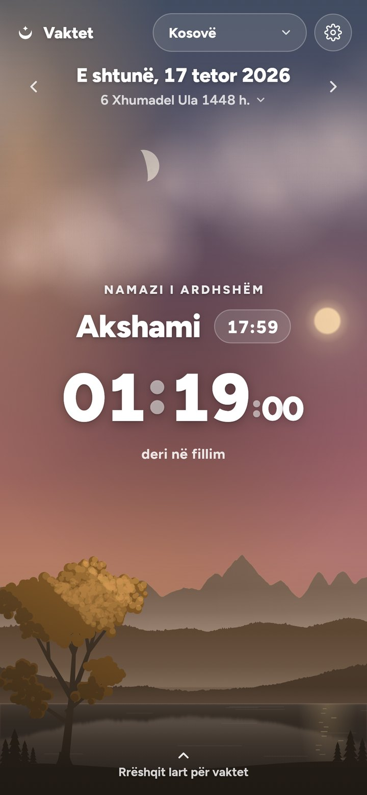
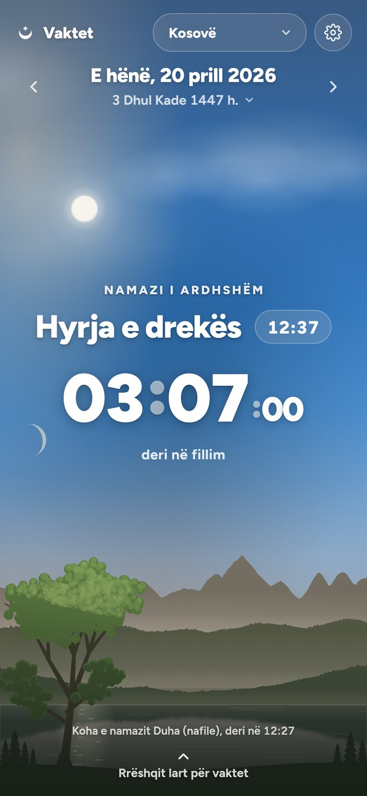
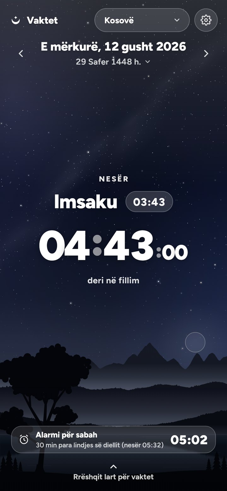
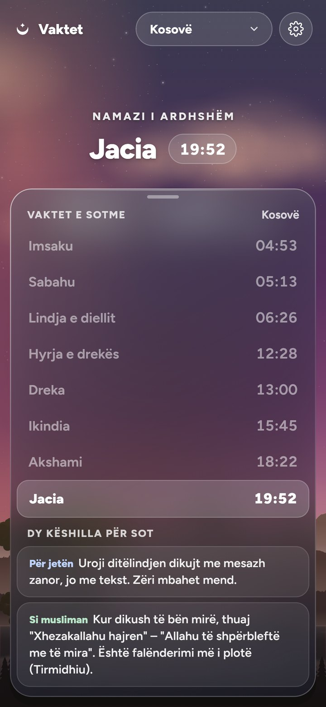

# Vaktet

### Kohët e namazit për Kosovën – të sakta, të bukura, pa reklama dhe pa internet

Kohët zyrtare nga **Takvimi i Bashkësisë Islame të Kosovës**, për 18 qytete, 
nën një qiell që ndjek orën, me hënën e vërtetë dhe male në mjegull.

&nbsp;

Android 1.9.11 · për telefona shumë të vjetër: [vaktet-arm32.apk](https://github.com/muamerarifi-pixel/Vaktet2026/releases/latest/download/vaktet-arm32.apk) · [të gjitha versionet](https://github.com/muamerarifi-pixel/Vaktet2026/releases)

 

 &nbsp;
 &nbsp;
 &nbsp;

---

## Pse Vaktet?

Vaktet nuk është një tabelë e thatë me orë. Është qielli i Kosovës në ekranin tënd: agimi skuqet ngadalë, mesdita është e kaltër, ikindia e artë, nata mbushet me yje, dhe pema buzë liqenit ndërron ngjyrat me stinët. E në mes të tij, sapo e hap, të pret e madhe dhe e qartë koha deri te namazi i ardhshëm.

🕌 **Kohët zyrtare të BIK-ut** – nga Takvimi i Bashkësisë Islame të Kosovës, për 18 qytete, me dallimin e secilit qytet. Jo llogaritje të përafërta.

⏳ **Një vështrim mjafton** – namazi i ardhshëm dhe koha e mbetur shihen menjëherë. Rrëshqit lart për të gjitha vaktet e ditës, alarmin për sabah dhe dy këshilla të reja çdo ditë; prek datën për muajin; rrëshqit anash për ditën tjetër.

🟢 **E dini menjëherë cili vakit ka hyrë** – mbi titullin e namazit të ardhshëm, një tregues elegant në xham të mjegullt me dritë të gjelbër ju tregon qartë vakitin aktual (p.sh. *„Ikindia tashmë ka hyrë“*), i grupuar dhe i centruar në mënyrë të përkryer simetrike në mes të ekranit.

⏰ **Sinkronizim i përpiktë me orën e telefonit** – koha dhe numërimi mbrapsht përputhen gjithmonë në sekondë me shiritin e sipërm të pajisjes tuaj, pa asnjë devijim edhe gjatë ndërrimit të stinëve (ora verore/dimërore).

🌅 **Një qiell i gjallë** – dielli dhe hëna e vërtetë, në fazën e saj të sotme, lindin e perëndojnë pas maleve. Retë lundrojnë, zogjtë dalin në mëngjes e kthehen në mbrëmje, mjegulla shtrihet në lugina, dhe në kohët e ndaluara qielli skuqet e të paralajmëron.

🌟 **E premtja në ar** – koha e mbetur shkëlqen në ar, dhe natën e xhumasë qielli mbushet me yje.

📅 **Gjithçka në një vend** – tabela e muajit, data hixhri, ditët kombëtare të Kosovës, netët e mëdha islame dhe shënimet e Takvimit të BIK.

🎨 **Si të pëlqen ty** – pamje e çelët ose e errët, shkronja të ndryshme, trashësia dhe madhësia e kohës së mbetur, dhe çdo veçori ndizet e fiket sipas dëshirës.

⚡ **E butë në çdo telefon** – çdo lëvizje ndjek gishtin pa ngecje, deri në 120 herë në sekondë.

📴 **Pa internet, përgjithmonë** – të gjitha kohët janë brenda aplikacionit, dhe ora verore e dimërore llogaritet vetë, vit pas viti.

🔒 **Pa reklama, pa llogari, pa gjurmim** – asnjë e dhënë nuk largohet nga telefoni yt.

---

## Risitë në versionin 1.9.11 (Android)

- 🌊 **Animacion i ujit me dritë e valëzim dinamik:** Shkëlqim horizontal i qetë, reflektim dinamik i rrezeve të diellit dhe dritës së hënës sipas koordinatave qiellore me lëkundje rrezatuese, dhe valëzim i lehtë në sipërfaqen e liqenit.
- 🪟 **Karta e cilësimeve me efekt xhami (Frosted Glass):** Dizajn modern me BackdropFilter të thellë (sigma 24), hije të butë lundruese dhe tranzicion të hijshëm të shkallëzuar gjatë hapjes.
- 🌳 **Pema me degëzim organik dhe gjethe me dritë skajore:** Degëzim i detajuar e i lakuar natyrshëm (bezier curves), kurorë me 3 nivele thellësie organike, efekt ere (wind sway) dhe ndriçim skajor (rim lighting) sipas stinës e dritës së diellit/hënës.
- 🔤 **Tipografi Manrope Light:** Stil i ri shkrimi modern dhe i lehtë për tekstin dhe numërimin.
- ✨ **Mikro-interaksione:** Lëvizje e rrjedhshme e shifrave të numërimit mbrapsht me fushë të palëkundur (pa dridhje), reagim delikat haptik gjatë ndryshimit të qytetit dhe hapjes së cilësimeve.

---
## Risitë në versionin 1.9.10 (Android)

- 🟢 **Treguesi i vakitit aktual sipas gjuhës standarde shqipe:** Mbi mbishkrimin „NAMAZI I ARDHSHËM“ shfaqet treguesi elegant i vakitit që tashmë ka hyrë (p.sh. *„Ikindia tashmë ka hyrë“*, *„Dreka tashmë ka hyrë“*, *„Xhumaja tashmë ka hyrë“*, *„Dielli tashmë ka lindur“*) me efekt *frosted glass* dhe tregues drite të gjelbër aktive.
- 📐 **Centrim simetrik i ekranit kryesor:** I gjithë blloku qendror (treguesi i vakitit aktual, titulli i namazit të ardhshëm, emri i vakitit me orën dhe numërimi mbrapsht) është i grupuar dhe i centruar në mënyrë të përkryer vertikalisht dhe horizontalisht në qendër të ekranit.
- ⏱️ **Sinkronizim i plotë me orën e telefonit (Device Status Bar):** Ora e brendshme e aplikacionit ndjek me saktësi absolute orën e sistemit operativ të telefonit, duke eliminuar diferencat gjatë ndërrimit të orës verore/dimërore.

---

## Si ta marrësh

**Android**
1. Shkarko **[vaktet-arm64.apk](https://github.com/muamerarifi-pixel/Vaktet2026/releases/latest/download/vaktet-arm64.apk)** – për pothuajse çdo telefon të viteve të fundit. Për telefona shumë të vjetër: [vaktet-arm32.apk](https://github.com/muamerarifi-pixel/Vaktet2026/releases/latest/download/vaktet-arm32.apk).
2. Hape në telefon. Nëse të pyet, lejo instalimin nga ky burim (një herë).
3. Gati – Vaktet është në ekranin kryesor.

Versioni i ri instalohet mbi të vjetrin. Nëse të del „App not installed”, çinstalo një herë versionin e vjetër dhe instalo të riun.

**iPhone, laptop ose çdo pajisje tjetër**
1. Hap [vaktet.muamer-arifi.workers.dev](https://vaktet.muamer-arifi.workers.dev).
2. Nga menyja e shfletuesit zgjidh **„Shto në ekranin kryesor"** / **„Install app"**.
3. Pas hapjes së parë punon edhe pa internet.

## Qytetet

Deçan · Dragash (Sharr) · Drenas · Ferizaj · Gjakovë · Gjilan · Istog · Klinë · Malishevë · Mitrovicë · Pejë · Podujevë · Prishtinë · Prizren · Rahovec · Skënderaj · Suharekë · Vushtrri – dhe kohët bazë për gjithë Kosovën.

---

<b>Për zhvilluesit</b>

#### Skedarët
| Skedari | Çfarë bën |
|---|---|
| `index.html` | Faqja |
| `styles.css` | Pamja, ngjyrat e qiellit, pamja e errët |
| `app.js` | Logjika: kohët, numërimi, qielli, cilësimet |
| `data.js` | Kohët e Takvimit të BIK për çdo ditë të vitit |
| `tips.js` | Këshillat e përditshme |
| `sw.js` | Puna pa internet |
| `manifest.webmanifest` | Instalimi si aplikacion |
| `wrangler.jsonc`, `_headers`, `.assetsignore` | Publikimi në Cloudflare dhe rregullat e cache-it |
| `vercel.json` | Rregullat e cache-it për Vercel |
| `fonts/`, `icons/` | Shkronja Figtree (licenca OFL) dhe ikonat |

#### Burimi i kohëve
Kohët janë nga Takvimi zyrtar i Bashkësisë Islame të Kosovës (BIK), 2026:
https://dituriaislame.com/wp-content/uploads/2026/01/takvimi2026vaktet.pdf

- Takvimi i BIK përsëritet sipas datës kalendarike çdo vit, prandaj tabela e ruajtur në `data.js` vlen edhe për vitet në vijim.
- Kohët ruhen në kohë standarde (UTC+1); aplikacioni shton vetë orën verore sipas zonës kohore `Europe/Belgrade` (që përdor Kosova), kështu që ndërrimi i orës mbetet i saktë në çdo vit.
- 29 shkurti (vitet e brishta) përdor kohët e 28 shkurtit.
- Dallimet e qyteteve sipas Takvimit: Prishtina, Ferizaj, Gjilani, Podujeva, Vushtrria −1 min; Sharri (Dragash) +2 min. Qytetet e tjera përdorin kohët bazë.

#### Publikimi në Cloudflare
Faqja është në **https://vaktet.muamer-arifi.workers.dev** (Cloudflare Workers, si skedarë statikë). Çdo ndryshim në degën `main` publikohet vetë nga Workers Builds (`npx wrangler deploy`, sipas `wrangler.jsonc`); `.assetsignore` e mban jashtë faqes aplikacionin Android, dokumentet dhe skedarët e publikimit.

#### Publikimi në Vercel (si mundësi tjetër)
1. Hapni vercel.com → Add New → Project → importoni këtë repository nga GitHub.
2. Framework Preset: **Other**. Nuk ka build – është faqe statike.
3. Deploy.

Për ta provuar në kompjuter: `npx serve .` dhe hapni adresën që shfaqet.

Për ta instaluar në telefon: hapni faqen → menyja e shfletuesit → "Shto në ekranin kryesor" / "Install app".

#### Aplikacioni Android (Flutter)
Dosja [`flutter_app/`](flutter_app/) e përmban aplikacionin Android, të ndërtuar me Flutter. Kohët dhe logjika janë të njëjta me faqen këtu (një test i krahason), dhe punon pa internet.

APK-të ndërtohen automatikisht nga GitHub Actions (skedari `.github/workflows/android-apk.yml`), një për çdo lloj procesori: `vaktet-arm64.apk` dhe `vaktet-arm32.apk`. Hapni **Actions → Android APK → ekzekutimin e fundit** dhe shkarkoni **vaktet-apk**, ose publikoni një version me **Run workflow → Publish a release**. Udhëzimet e plota janë te [`flutter_app/README.md`](flutter_app/README.md).

`.vercelignore` e mban dosjen `flutter_app/` jashtë faqes në Vercel.

#### Përditësimi
Nëse ndryshoni ndonjë skedar, rrisni versionin `CACHE` në `sw.js` (p.sh. `vaktet-v22`) që pajisjet ta marrin versionin e ri.

