

# Vaktet

### Kohët e namazit për Kosovën – të sakta, të bukura, pa reklama dhe pa internet

Kohët zyrtare nga **Takvimi i Bashkësisë Islame të Kosovës**, për 18 qytete, 
nën një qiell që ndjek orën, me hënën e vërtetë dhe male në mjegull.

&nbsp;

Android 1.9 · për telefona shumë të vjetër: [vaktet-arm32.apk](https://github.com/muamerarifi-pixel/Vaktet2026/releases/latest/download/vaktet-arm32.apk) · [të gjitha versionet](https://github.com/muamerarifi-pixel/Vaktet2026/releases)

 

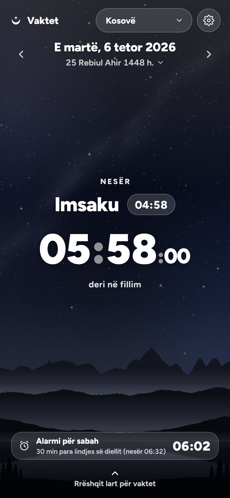 &nbsp;
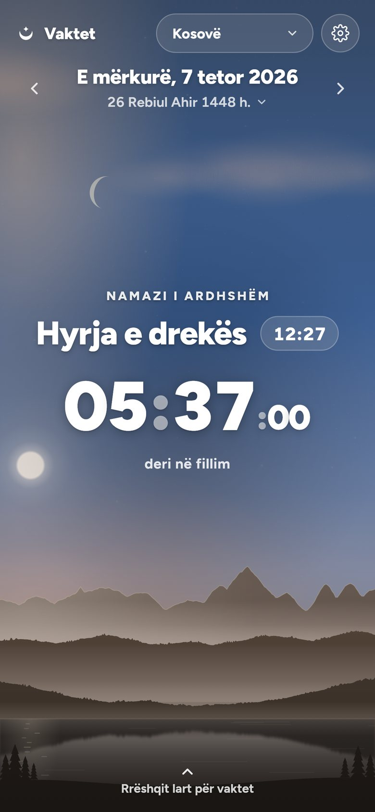 &nbsp;
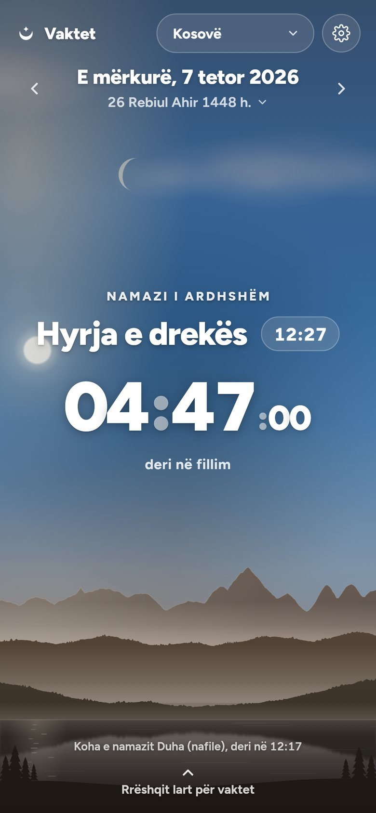 &nbsp;
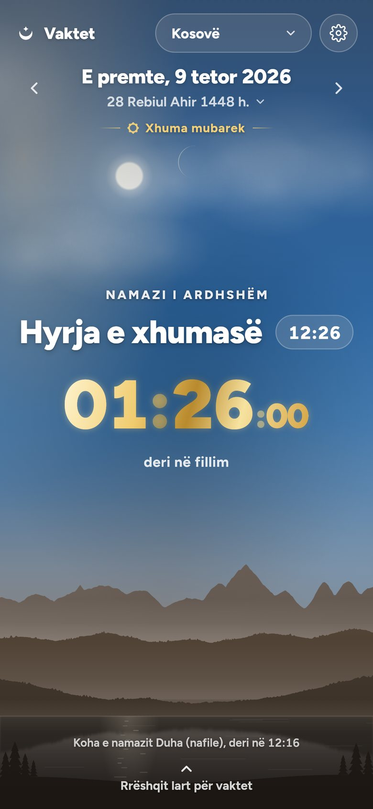 &nbsp;
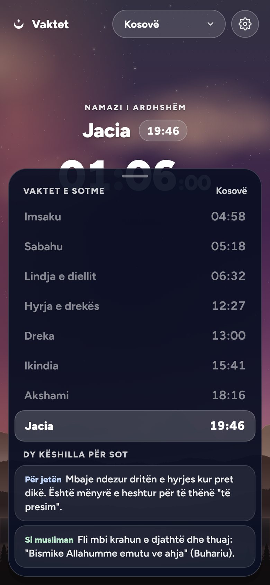

---

## Një ditë në qiellin e Vaktet

<table>
<tr><td align="center">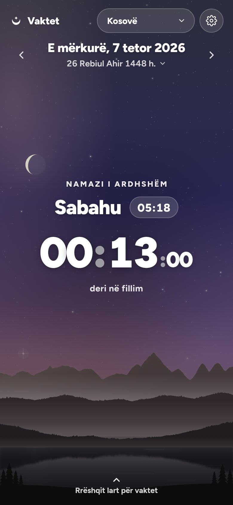 Agimi · 05:05</td><td align="center"> Lindja e diellit · 06:50</td><td align="center"> Mjegull në lugina · 07:40</td></tr>
<tr><td align="center">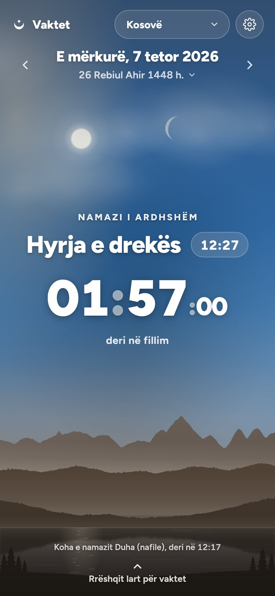 Paradite · 10:30</td><td align="center">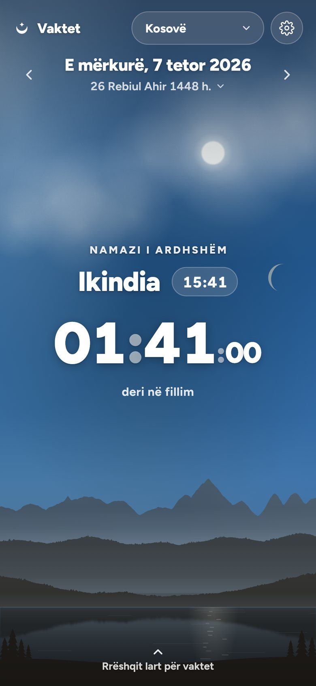 Re pasdite · 14:00</td><td align="center">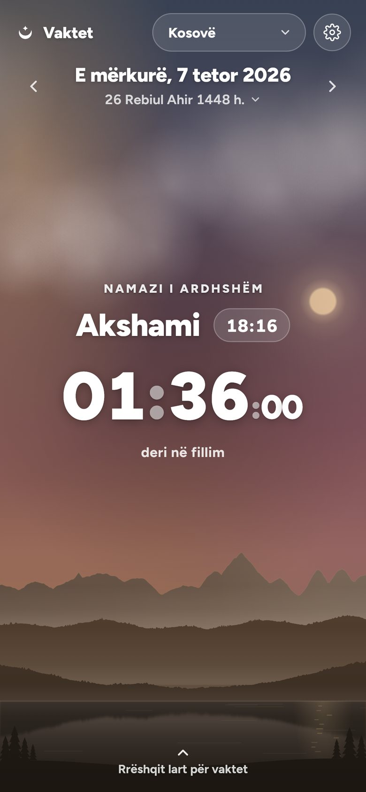 Ora e artë · 16:40</td></tr>
<tr><td align="center">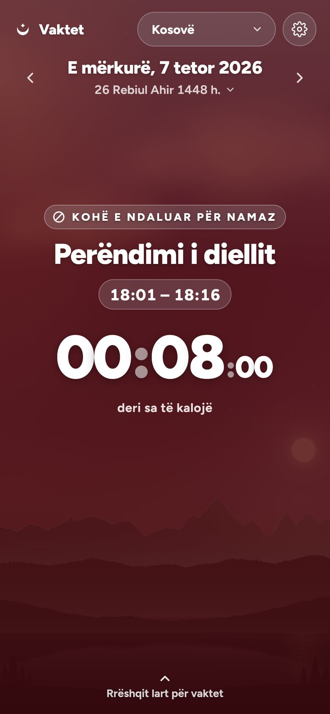 Kohë e ndaluar · 18:08</td><td align="center">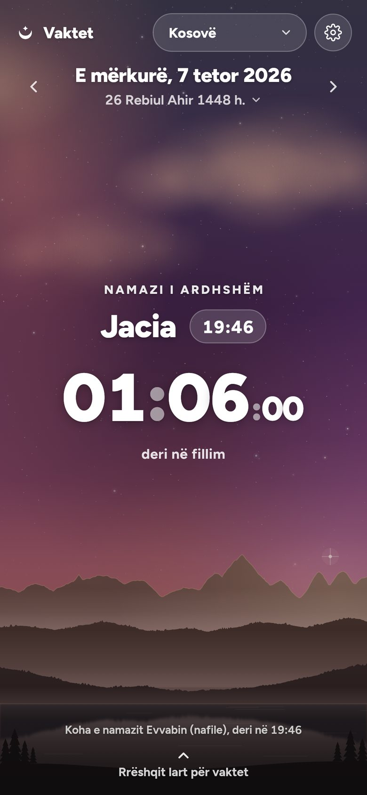 Muzgu · 18:40</td><td align="center">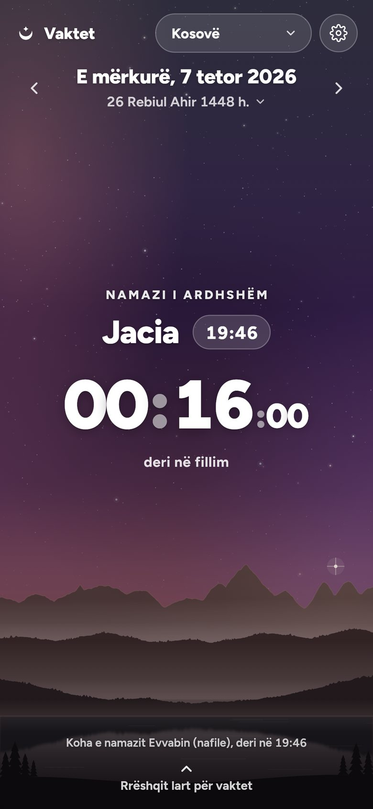 Mbrëmja · 19:30</td></tr>
<tr><td align="center"> Kashta e Kumtrit · 23:00</td><td align="center">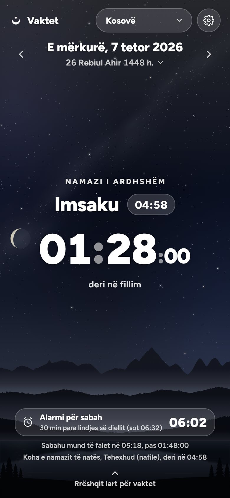 Hëna lind · 03:30</td><td align="center">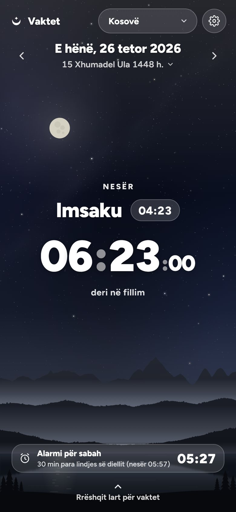 Hëna e plotë · 22:00</td></tr>
<tr><td align="center">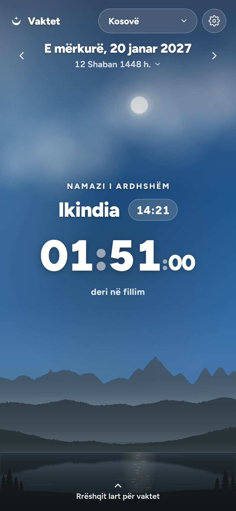 Dimri · 12:30</td><td align="center">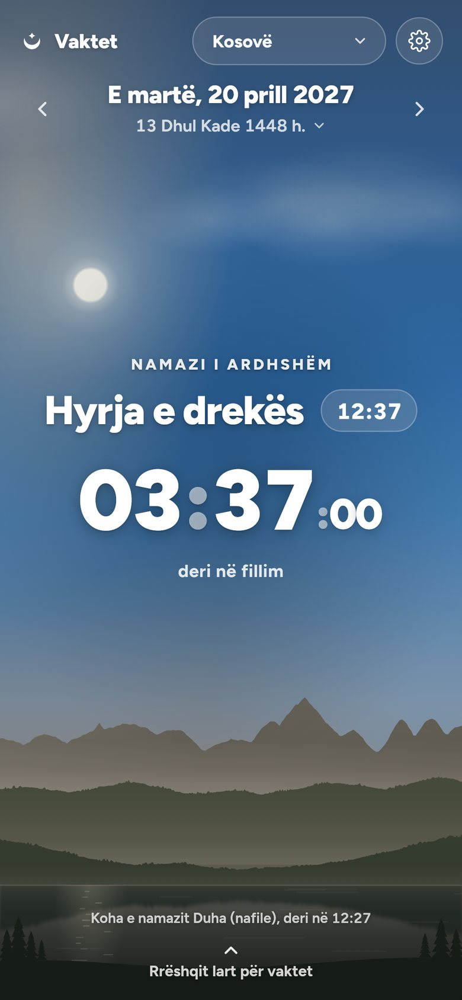 Pranvera · 09:00</td><td align="center">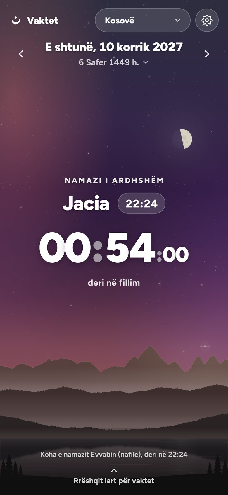 Mbrëmje vere · 21:30</td></tr>
</table>

## Edhe më

<table>
<tr><td align="center"> E premtja, në ar</td><td align="center">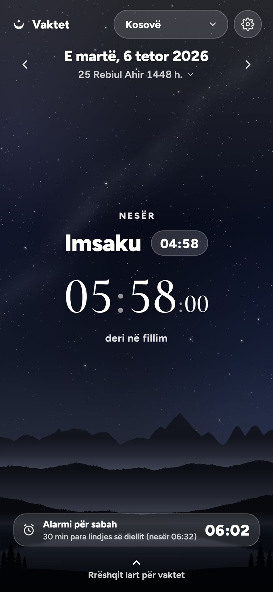 Shkronjat „Elegante"</td><td align="center"> Vaktet, të rrëshqitura lart</td></tr>
<tr><td align="center">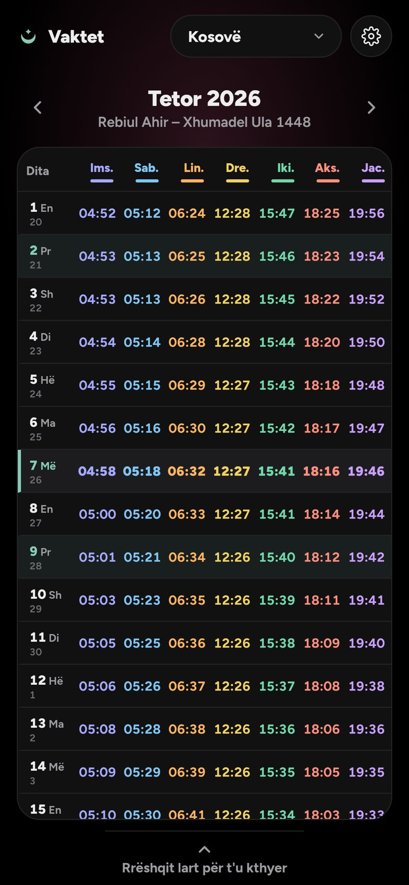 Muaji</td><td align="center">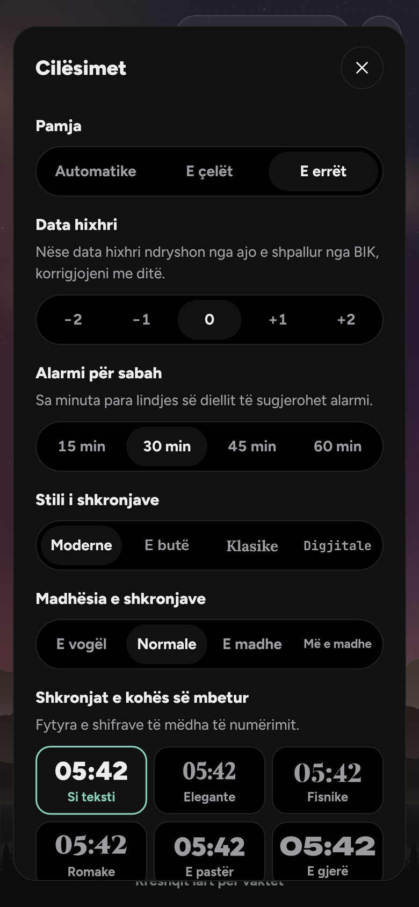 Cilësimet</td><td></td></tr>
</table>

## Të reja në versionin 1.9

⚡ **I shpejtë dhe i rrjedhshëm në çdo telefon** – aplikacioni kërkon shpejtësinë më të lartë të ekranit (90 ose 120 Hz, aty ku telefoni e ka), dhe qielli e shifrat lëvizin në çdo rifreskim të tij, jo më 20 herë në sekondë. Pjesët e qiellit që nuk lëvizin (ngjyrat, yjet e zbehtë, Kashta e Kumtrit, malet, liqeni, mjegulla, dielli) vizatohen një herë si pamje, kështu çdo kuadër mbetet i lehtë edhe në telefona të thjeshtë.

👆 **Vaktet ndjekin gishtin pa u dridhur** – telefoni i ndien prekjet 120–240 herë në sekondë, jo njëkohësisht me ekranin; tani pozicioni i gishtit gjendet për çdo kuadër mes dy prekjeve, dhe vaktet ngjiten me hapa të barabartë. Koha e mbetur ngjitet pa u zvogëluar dhe mbetet mbi xhamin e turbullt, pa u ndërtuar përsëri kur nis rrëshqitja.

🔋 **Pa kursim baterie** – qielli nuk pushon më pas 30 sekondave, as kur telefoni kursen baterinë, as nën vaktet: lëviz gjithmonë kur shihet, dhe ndalet vetëm kur aplikacioni nuk është në ekran. Cilësimi **Qielli pushon** u hoq.

## Të reja në versionin 1.8

🫧 **Vaktet rrëshqasin pa ngecje** – sapo vaktet nisin të ngjiten, qielli pushon dhe tregohet si një pamje e vetme, dhe vetë vaktet lëvizin si pamje: çdo kuadër lëviz vetëm dy pamje, jo gjithë qiellin me male e mjegull. Asgjë në qiell nuk kërcen apo zhduket kur ato hapen.

🔮 **Koha e mbetur mbi xham** – shifrat qëndrojnë mbi një xham të vërtetë që e turbullon qiellin pas tyre, me një buzë që kap dritën (në ar të premteve). Mund ta fikësh te Cilësimet → **Xhami i turbullt**.

🕌 **Vaktet pa rrëshqitur** – te Cilësimet → **Vaktet pa rrëshqitur**: të shtatë vaktet e ditës shihen në fund të qiellit, në një shirit xhami, me vaktin e ardhshëm të ndriçuar. Një prekje hap gjithë vaktet me alarmin dhe këshillat.

## Të reja në versionin 1.7

🔋 **Më pak bateri** – qielli pushon 30 sekonda pas prekjes së fundit (koha e mbetur vazhdon; një prekje e zgjon), dhe ndalet edhe kur telefoni kursen baterinë ose kur vaktet e mbulojnë. Kur lëviz, vizatohet 20 herë në sekondë dhe jo 60–120 sa ekrani; retë, mjegulla dhe yjet e zbehtë vizatohen një herë e jo në çdo pamje, dhe ekrani ndërtohet përsëri një herë në minutë – vetëm sekondat ndryshojnë çdo sekondë. Mund ta fikësh te Cilësimet → **Qielli pushon**.

👆 **Vaktet rrëshqasin butë** – ndjekin gishtin saktë që në rrëshqitjen e parë, hapen e mbyllen më shpejt dhe pa ngecje.

🏔️ **Më pak shtresa** – para maleve tani janë vetëm dy kodra me pyje, me mjegull mes tyre.

📦 **APK më i vogël** – rreth një e treta e madhësisë së mëparshme.

## Të reja në versionin 1.6

🏔️ **Male si në një fotografi nate** – një varg malesh në largësi, i ulët e shkëmbor, dhe kodra me pyje para tij, me mjegull që shtrihet mes tyre. Ngjyrat vijnë nga qielli i çastit: natën pothuajse të zeza nën një dritë të zbehtë mbi horizont, nën hënën e plotë mjegulla dhe malet ndriçohen pak, ditën malet janë të kaltra nga largësia, dhe në lindje e në perëndim ajri skuqet nga ana e diellit.

❄️ **Pa borë** – as në male, as në pemë, dhe liqeni nuk ngrin më: kalendari nuk e di motin.

✨ **Qielli i natës** – më i errët e më i qetë, me qindra yje të imët deri te malet, një rrip më i çelët ajri mbi horizont dhe Kashta e Kumtrit si re e butë drite.

⏱️ **Sekondat më të vogla** – sa gjysma e orëve e minutave, dhe çdo shifër që ndryshon shuhet butë në tjetrën.

## Nga versionet 1.4 dhe 1.5

🌟 **E premtja** – koha e mbetur shkëlqen në ar, nën datë „Xhuma mubarek"; natën e xhumasë (të enjten pas akshamit) qielli mbushet me yje.

🔢 **Shkronja për kohën e mbetur** – Elegante, Fisnike, Romake, E pastër dhe E gjerë. Shifrat nuk lëvizin kur ndryshojnë.

📅 **Prek datën për muajin** – titujt e vakteve qëndrojnë lart ndërsa ditët rrëshqasin, dhe çdo vakt ka ngjyrën e vet.

🗓️ **Ditët e veçanta** – ditët kombëtare të Kosovës, netët dhe ditët e mëdha islame dhe shënimet e Takvimit të BIK poshtë datës.

⏰ **Alarmi për sabah në ekran** nga jacia deri në imsak, dhe namazet nafile (Duha, Evvabini, Tehexhudi) me shkronja të vogla kur u vjen koha.

⚙️ **Gjithçka sipas teje** – çdo veçori ndizet e fiket te Cilësimet → Veçoritë.

## Pse Vaktet?

🕌 **Kohët zyrtare të BIK-ut** – jo llogaritje të përafërta. Me dallimet e qyteteve sipas Takvimit (Prishtina −1 min, Sharri +2 min …).

⏳ **Sa kohë ka mbetur?** – Namazi i ardhshëm dhe numërimi mbrapsht i madh shihen menjëherë, pa kërkuar nëpër tabela.

🌅 **Një qiell që ndjek orën** – agimi skuqet ngadalë, mesdita është e kaltër, ikindia e artë, muzgu zbehet në blu, nata mbushet me yje. Dielli dhe hëna e vërtetë (në fazën e saj të sotme) lindin e perëndojnë pas maleve; retë ndryshojnë sipas orës, zogjtë dalin në mëngjes e kthehen në mbrëmje, dhe herë pas here bie një yll.

⛔ **Kohët e ndaluara** – në lindje, zenit e perëndim të diellit qielli bëhet i kuq dhe të paralajmëron.

🧘 **Vetëm thelbi** – qielli mbush ekranin me kohën e mbetur. Rrëshqit lart për vaktet, alarmin dhe dy këshilla të reja çdo ditë; prek datën për muajin; rrëshqit anash për ditën tjetër ose të mëparshme.

⏰ **Alarmi për sabah** – të sugjeron orën e alarmit 15, 30, 45 ose 60 minuta para lindjes së diellit.

📅 **Tabela e muajit** dhe **data hixhri**, me korrigjim ±2 ditë nëse shpallja e BIK-ut ndryshon.

🎨 **Si të pëlqen ty** – pamje e çelët, e errët ose automatike; stili dhe madhësia e shkronjave; trashësia dhe shkronjat e kohës së mbetur.

📴 **Pa internet, përgjithmonë** – të gjitha kohët janë brenda aplikacionit. Ora verore e dimërore llogaritet vetë, prandaj kohët mbeten të sakta edhe në vitet në vijim.

🔒 **Pa reklama, pa llogari, pa gjurmim** – asnjë e dhënë nuk largohet nga telefoni yt.

## Si ta marrësh

**Android**
1. Shkarko **[vaktet-arm64.apk](https://github.com/muamerarifi-pixel/Vaktet2026/releases/latest/download/vaktet-arm64.apk)** – për pothuajse çdo telefon të viteve të fundit. Për telefona shumë të vjetër: [vaktet-arm32.apk](https://github.com/muamerarifi-pixel/Vaktet2026/releases/latest/download/vaktet-arm32.apk).
2. Hape në telefon. Nëse të pyet, lejo instalimin nga ky burim (një herë).
3. Gati – Vaktet është në ekranin kryesor.

Versioni i ri instalohet mbi të vjetrin. Nëse të del „App not installed”, çinstalo një herë versionin e vjetër dhe instalo të riun.

**iPhone, laptop ose çdo pajisje tjetër**
1. Hap [vaktet.muamer-arifi.workers.dev](https://vaktet.muamer-arifi.workers.dev).
2. Nga menyja e shfletuesit zgjidh **„Shto në ekranin kryesor"** / **„Install app"**.
3. Pas hapjes së parë punon edhe pa internet.

Versioni në shfletues ka ende qiellin e versionit 1.3; risitë e reja vijnë fillimisht në Android.

## Qytetet

Deçan · Dragash (Sharr) · Drenas · Ferizaj · Gjakovë · Gjilan · Istog · Klinë · Malishevë · Mitrovicë · Pejë · Podujevë · Prishtinë · Prizren · Rahovec · Skënderaj · Suharekë · Vushtrri – dhe kohët bazë për gjithë Kosovën.

---

## Për zhvilluesit

### Skedarët
| Skedari | Çfarë bën |
|---|---|
| `index.html` | Faqja |
| `styles.css` | Pamja, ngjyrat e qiellit, pamja e errët |
| `app.js` | Logjika: kohët, numërimi, qielli, cilësimet |
| `data.js` | Kohët e Takvimit të BIK për çdo ditë të vitit |
| `tips.js` | Këshillat e përditshme |
| `sw.js` | Puna pa internet |
| `manifest.webmanifest` | Instalimi si aplikacion |
| `wrangler.jsonc`, `_headers`, `.assetsignore` | Publikimi në Cloudflare dhe rregullat e cache-it |
| `vercel.json` | Rregullat e cache-it për Vercel |
| `fonts/`, `icons/` | Shkronja Figtree (licenca OFL) dhe ikonat |

### Burimi i kohëve
Kohët janë nga Takvimi zyrtar i Bashkësisë Islame të Kosovës (BIK), 2026:
https://dituriaislame.com/wp-content/uploads/2026/01/takvimi2026vaktet.pdf

- Takvimi i BIK përsëritet sipas datës kalendarike çdo vit, prandaj tabela e ruajtur në `data.js` vlen edhe për vitet në vijim.
- Kohët ruhen në kohë standarde (UTC+1); aplikacioni shton vetë orën verore sipas zonës kohore `Europe/Belgrade` (që përdor Kosova), kështu që ndërrimi i orës mbetet i saktë në çdo vit.
- 29 shkurti (vitet e brishta) përdor kohët e 28 shkurtit.
- Dallimet e qyteteve sipas Takvimit: Prishtina, Ferizaj, Gjilani, Podujeva, Vushtrria −1 min; Sharri (Dragash) +2 min. Qytetet e tjera përdorin kohët bazë.

### Publikimi në Cloudflare
Faqja është në **https://vaktet.muamer-arifi.workers.dev** (Cloudflare Workers, si skedarë statikë). Çdo ndryshim në degën `main` publikohet vetë nga Workers Builds (`npx wrangler deploy`, sipas `wrangler.jsonc`); `.assetsignore` e mban jashtë faqes aplikacionin Android, dokumentet dhe skedarët e publikimit.

### Publikimi në Vercel (si mundësi tjetër)
1. Hapni vercel.com → Add New → Project → importoni këtë repository nga GitHub.
2. Framework Preset: **Other**. Nuk ka build – është faqe statike.
3. Deploy.

Për ta provuar në kompjuter: `npx serve .` dhe hapni adresën që shfaqet.

Për ta instaluar në telefon: hapni faqen → menyja e shfletuesit → "Shto në ekranin kryesor" / "Install app".

### Aplikacioni Android (Flutter)
Dosja [`flutter_app/`](flutter_app/) e përmban aplikacionin Android, të ndërtuar me Flutter. Kohët dhe logjika janë të njëjta me faqen këtu (një test i krahason), dhe punon pa internet.

APK-të ndërtohen automatikisht nga GitHub Actions (skedari `.github/workflows/android-apk.yml`), një për çdo lloj procesori: `vaktet-arm64.apk` dhe `vaktet-arm32.apk`. Hapni **Actions → Android APK → ekzekutimin e fundit** dhe shkarkoni **vaktet-apk**, ose publikoni një version me **Run workflow → Publish a release**. Udhëzimet e plota janë te [`flutter_app/README.md`](flutter_app/README.md).

`.vercelignore` e mban dosjen `flutter_app/` jashtë faqes në Vercel.

### Përditësimi
Nëse ndryshoni ndonjë skedar, rrisni versionin `CACHE` në `sw.js` (p.sh. `vaktet-v22`) që pajisjet ta marrin versionin e ri.
